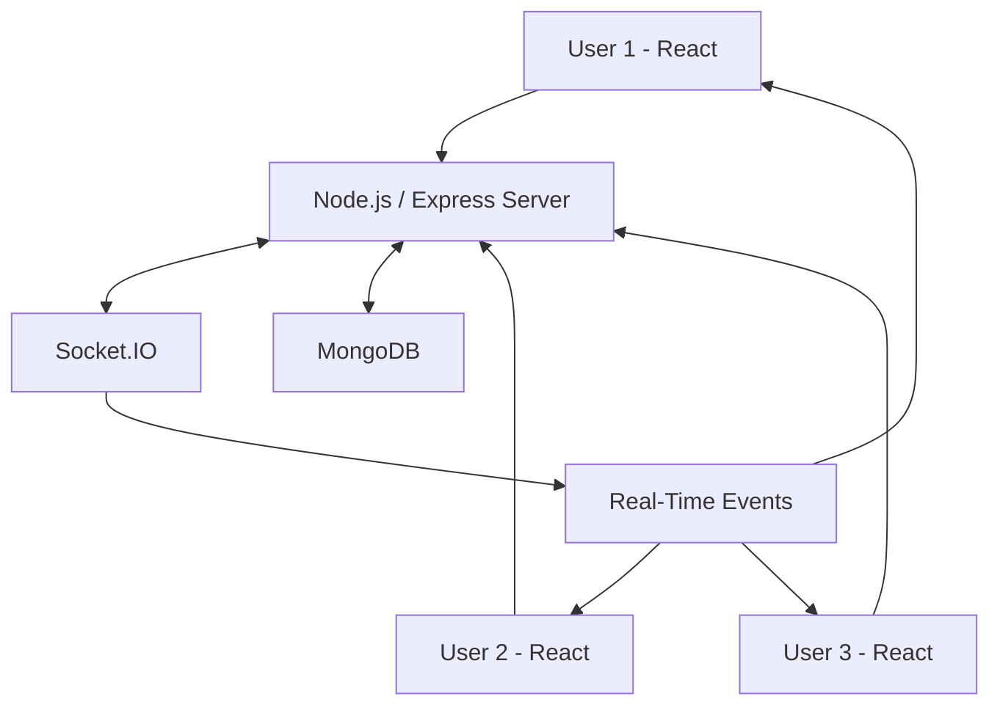

# 🎬 MovieSync

### Watch Together. Stay in Sync.

MovieSync is a real-time movie-watching platform that allows users to watch movies together with friends, regardless of their physical location. It uses **Socket.IO** to synchronize playback events and provide a seamless collaborative viewing experience.

Instead of watching movies separately and manually coordinating playback, users can join a shared room and enjoy synchronized movie streaming.

---

## ✨ Key Features

- 🎥 **Synchronized Video Playback:** Play, pause, and seek actions are synchronized across users in a room.
- 🏠 **Room-Based Watching:** Create or join rooms to watch movies together.
- ⚡ **Real-Time Communication:** Socket.IO enables instant communication between connected users.
- 🔐 **User Authentication:** Secure authentication using JSON Web Tokens (JWT).
- 🌐 **Full-Stack Architecture:** Separate frontend and backend applications.
- 📱 **Interactive Interface:** A user-friendly interface for collaborative movie watching.

## 🛠️ Tech Stack

| Technology | Purpose |
|---|---|
| React.js | Frontend development |
| Node.js | Backend runtime |
| Express.js | REST API development |
| MongoDB | Database |
| Socket.IO | Real-time communication |
| JWT | Authentication |
| JavaScript | Application development |
| Git & GitHub | Version control |

## 🏗️ System Architecture

MovieSync follows a client-server architecture.



### How It Works

1. Users access the application through the React frontend.
2. The backend handles API requests and authentication.
3. Users create or join a shared movie-watching room.
4. Socket.IO establishes real-time communication between connected users.
5. When a user performs an action such as play, pause, or seek, the event is transmitted to the server.
6. The server broadcasts the corresponding update to other users in the room.
7. All connected users maintain synchronized playback.

## 📂 Project Structure

```text
MovieSync/
│
├── backend/
│   ├── config/
│   ├── controllers/
│   ├── models/
│   ├── routes/
│   ├── middleware/
│   └── server.js
│
├── frontend/
│   ├── public/
│   ├── src/
│   │   ├── components/
│   │   ├── pages/
│   │   ├── context/
│   │   └── App.js
│   └── package.json
│
└── README.md
```

*Note: The directory structure above illustrates the main application organization. Adjust individual folder names to match the actual source code.*

## ⚙️ Installation & Setup

Follow these steps to run MovieSync locally.

### 1. Clone the Repository

```bash
git clone https://github.com/RahulGariya/Movie-Sync.git
```

```bash
cd MovieSync
```

### 2. Setup Backend

```bash
cd backend
npm install
```

Configure the backend environment variables in a `.env` file according to the requirements in your backend configuration.

Example configuration:

```env
PORT=5000
MONGO_URI=your_mongodb_connection_string
JWT_SECRET=your_jwt_secret
```

Start the backend using the start script defined in `backend/package.json`:

```bash
npm start
```

### 3. Setup Frontend

Open another terminal:

```bash
cd frontend
npm install
```

Configure the frontend API and Socket.IO server URLs according to your application configuration.

Start the frontend using the script defined in `frontend/package.json`:

```bash
npm start
```

### 4. Access the Application

Open your browser and navigate to the local frontend URL displayed in the terminal.

## 🔄 Real-Time Synchronization

One of the core components of MovieSync is Socket.IO.

It enables real-time communication between users without requiring continuous HTTP requests.

**Example workflow:**

- User A clicks the Play button.
- The frontend emits a playback event through Socket.IO.
- The backend receives the event.
- The server broadcasts the event to other users in the same room.
- User B receives the event and updates their video player.

The same mechanism is used for pause and seek operations.

## 🔒 Authentication

MovieSync uses JSON Web Tokens (JWT) for user authentication.

The authentication workflow:

1. A user submits login credentials.
2. The backend validates the credentials.
3. A JWT is generated after successful authentication.
4. The token is used to authenticate subsequent protected requests.

## 🚀 Future Improvements

- Integrated voice and text chat.
- Improved synchronization for users with different network speeds.
- Support for additional video formats.
- Enhanced room management.
- Improved mobile responsiveness.
- Better handling of network interruptions and reconnections.

## 👨‍💻 Contributors

MovieSync was developed as a collaborative full-stack development project by:

| Contributor | GitHub Profile |
|---|---|
| Rahul Gariya | [@RahulGariya](https://github.com/RahulGariya) |
| Yogesh Pandey | [@ypandey700](https://github.com/ypandey700) |
| Umesh Kumar | [@umesshk](https://github.com/umesshk) |
| Prabhakar Nainwal | [@Prabhakar-Nainwal](https://github.com/Prabhakar-Nainwal) |

## 📌 Repository

**GitHub Repository:** [MovieSync](https://github.com/RahulGariya/Movie-Sync)

---

⭐ If you find MovieSync interesting, don't forget to star the repository!

**MovieSync – Bringing people together, one movie at a time.**

⭐ If you find this project interesting, consider giving the repository a star!

**MovieSync – Bringing people together, one movie at a time.**
